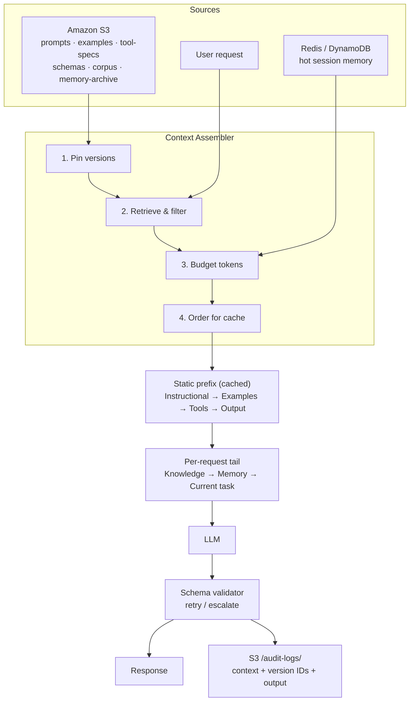

# Context Engineering for Fintech

**From 6 context types to a production-grade context assembler, built step by step and finished with a fintech capstone.**

Most LLM failures in production come from the context, not the prompt wording: the wrong information, in the wrong order, at the wrong time, with no record of what the model actually saw. This repo is a hands-on series that treats context as an engineered system: versioned, budgeted, ordered, validated and auditable.


---

## Series roadmap

| # | Module | What you'll learn | Status |
|---|--------|-------------------|--------|
| 1 | [Context Types](modules/01-context-types/) | The 6 building blocks of every LLM call, how to build each one, and the cost of getting it wrong | ✅ Available |
| 2 | [Context Assembly Order](modules/02-assembly-order/) | Why order changes cost, accuracy and cacheability: static-first, task-last | 🔜 Coming soon |
| 3 | [Right Info at Right Time](modules/03-right-info-right-time/) | Just-in-time retrieval, relevance thresholds, token budgets, memory summarisation | 🔜 Coming soon |
| 4 | [Context Templates](modules/04-context-templates/) | Versioned, testable templates stored in S3, with one template per use case | 🔜 Coming soon |
| 5 | [Project: Assembly Pipeline](modules/05-assembly-pipeline/) | The assembler as a service: pin, retrieve, budget, order, validate, audit | 🔜 Coming soon |
| 6 | [Capstone: Fintech Dispute Assistant](modules/06-capstone-fintech/) | An end-to-end card chargeback assistant on AWS | 🔜 Coming soon |

Each module builds on the previous one. By Module 6 you have a working, auditable context pipeline for a regulated domain.

---

## Repository structure

```
context-engineering-fintech/
├── README.md
├── docs/
│   └── images/
│       └── context-assembler.png
├── modules/
│   ├── 01-context-types/
│   │   ├── six_context_types.py
│   │   └── cost_calculator.py
│   ├── 02-assembly-order/
│   ├── 03-right-info-right-time/
│   ├── 04-context-templates/
│   ├── 05-assembly-pipeline/
│   └── 06-capstone-fintech/
└── requirements.txt
```

## Quick start

```bash
git clone https://github.com/vinothbtechit/context-engineering-fintech.git
cd context-engineering-fintech
python modules/01-context-types/six_context_types.py
python modules/01-context-types/cost_calculator.py
```

Module 1 needs only Python 3.10+ with no external dependencies. Later modules add AWS (S3, DynamoDB, a vector index) and an LLM provider of your choice.

---

## Module 1 at a glance: the 6 context types

| Type | What it carries | Changes per request? | Example (dispute assistant) |
|------|-----------------|----------------------|-----------------------------|
| **1. Instructional** | Role, behaviour rules, constraints | No | "You are a disputes analyst. Never promise outcomes." |
| **2. Examples** | Few-shot input/output pairs | No | 3 past dispute cases, written in the output JSON |
| **3. Knowledge** | Retrieved documents (RAG) | Yes | Network chargeback rules, bank SOP |
| **4. Memory** | Conversation history and user profile | Yes | This customer's last 2 disputes |
| **5. Tools** | Functions the model may call | No | `get_transactions(card_id)`, `raise_dispute(txn_id, reason_code)` |
| **6. Output** | Response format and schema | No | `{eligible, reason_code, evidence_needed, next_action}` |

**Rule of thumb:** write examples in the exact output schema. Models copy examples more faithfully than they follow format instructions.

### Why it matters: [`cost_calculator.py`](modules/01-context-types/cost_calculator.py)

Skipping engineered context (types 3–4 especially) and dumping raw documentation into every request doesn't just hurt accuracy — it shows up directly on the bill. Running the script on a 10K-requests/day scenario:

```
Bad Context (Document Dump)      Input tokens: 50,000   Monthly cost: $47,250.00
Medium Context (Some RAG)        Input tokens: 10,000   Monthly cost: $11,250.00
Good Context (Engineered)        Input tokens: 2,000    Monthly cost: $4,050.00

MONTHLY SAVINGS: $43,200.00 (91%)
YEARLY SAVINGS: $518,400.00
```

Same task, same model, 91% lower cost — just from engineering what goes into the context window.

---

## The Context Assembler

The assembler is the layer that turns the 6 types into a single LLM call. It runs on every request, before the model sees anything.



| Stage | What it does | Why it matters |
|-------|--------------|----------------|
| **Pin versions** | Resolves prompt, examples, tools and schema to exact S3 object versions | Every answer can be reproduced and rolled back |
| **Retrieve & filter** | Top-k search, drops low-relevance docs, wraps docs in `<document>` tags | Less noise, and retrieved text is treated as data rather than instructions |
| **Budget tokens** | Trims memory and documents to fit the window, by tokens rather than turns | Prevents silent truncation and runaway cost |
| **Order for cache** | Static blocks first, dynamic blocks last, task at the very end | Keeps the prefix cacheable across requests |

---

## How Amazon S3 is used

S3 is the versioned source of truth for everything the assembler reads, and the durable record of everything the model saw.

| S3 prefix | Context type | Role |
|-----------|--------------|------|
| `/prompts/` | Instructional | Versioned system prompts; roll back by object version |
| `/examples/` | Examples | Curated few-shot library per use case |
| `/tool-specs/` | Tools | JSON Schema / OpenAPI definitions |
| `/schemas/` | Output | Response schemas used by the validator |
| `/corpus/` | Knowledge | Raw documents, embedded into a vector index |
| `/memory-archive/` | Memory | Long-term conversation summaries (hot memory stays in Redis/DynamoDB) |
| `/audit-logs/` | — | Assembled context, version IDs, doc sources and output for every decision |

**Why S3:** object versioning for rollback, cheap durable storage, lifecycle rules to move old audit logs to Glacier, and decoupling: compliance teams can update an SOP and the next request uses it, with no redeploy.

---

## Capstone preview: Card Dispute Assistant

A bank operations analyst asks:

> "Customer says ₹4,999 was charged twice at a merchant. Eligible for chargeback?"

The assistant pulls the transaction history through a tool call, retrieves the relevant network rules and bank SOP, checks the customer's dispute history, and returns a validated decision:

```json
{
  "eligible": true,
  "reason_code": "DUPLICATE_PROCESSING",
  "evidence_needed": ["both transaction IDs", "merchant settlement record"],
  "next_action": "raise_dispute"
}
```

Every decision is written to S3 with the exact prompt, example, schema and document versions used, ready for audit replay.

---

## Business value

| Benefit | How the design delivers it |
|---------|----------------------------|
| **Lower cost** | Static-first ordering keeps the prefix cacheable, so cached tokens bill at a fraction of the normal input price |
| **Higher accuracy** | Examples written in the output schema produce fewer malformed responses |
| **Safer** | Retrieved documents enter as data, which closes a common prompt-injection path |
| **Auditable** | Any answer can be replayed from its pinned versions, which matters in regulated domains |
| **Faster change** | Business teams update S3 content, not code |
| **Model-agnostic** | The assembler sits in front of any LLM, so switching models doesn't change the pipeline |

### Value return (illustrative)

```
20,000 disputes/month × 8 minutes saved per case ≈ 2,670 analyst hours/month
```

On top of that, caching a ~5k-token static prefix that repeats on every call cuts input cost before you change the model at all. *These figures are assumptions for illustration. Replace them with your own volumes and handling times.*

---

## Design principles

1. **Context is code.** Version it, review it, test it.
2. **Static first, dynamic last.** Order for the cache and put the task at the end.
3. **Retrieved text is data.** Wrap it and never let it act as instructions.
4. **Budget by tokens.** Use tokens, not turns or document counts.
5. **Validate every output.** Check against a schema, then retry or escalate.
6. **Log what the model saw.** Without this you can't audit a decision.

---

## Follow the series

New modules are published alongside a LinkedIn post that explains the idea. Star or watch this repo to get updates.

**Author:** Vinoth — [LinkedIn](https://www.linkedin.com/in/vinotharunagiri/)

## Contributing

Issues and pull requests are welcome, especially real-world fintech use cases, better evaluation approaches, and corrections.

## License

MIT. See [LICENSE](LICENSE).

---

*Researched by the author; phrasing assisted by AI.*